# Student Management System

AWAD (BUC3131) Coursework Two, Makerere University Business School, 2026/2027.

A Laravel 12 web application for managing students, courses, lecturers and course registrations.
Administrators manage records, lecturers view their assigned courses and registered students, and
students browse available courses and manage their own registrations.

## Features

| Area | What it does |
| --- | --- |
| Database | Migrations for `students`, `lecturers`, `courses` and `course_registrations` with foreign keys and a unique `(student_id, course_id)` index that blocks duplicate registrations |
| Relationships | `hasMany`, `belongsTo`, `hasOne` and `belongsToMany` (students ↔ courses through `course_registrations`) |
| Seeders | Roles, permissions, sample users, 6 students, 5 courses and 10 registrations. Safe to run repeatedly (`firstOrCreate` / `updateOrCreate`) |
| Authentication | Login / logout with session regeneration and login throttling (5 attempts per minute) |
| Roles & permissions | [spatie/laravel-permission](https://spatie.be/docs/laravel-permission) with `admin`, `lecturer` and `student` roles |
| Authorisation | `auth` / `guest` middleware on routes and policies (`StudentPolicy`, `CoursePolicy`, `CourseRegistrationPolicy`) that stop users opening other users' records |
| Students | Full CRUD with search, pagination, validation and an optional login account for each student |
| Courses | Full CRUD with lecturer assignment, capacity and validation |
| Registrations | Register / drop with validation, duplicate prevention and a capacity check |
| Views | One reusable Blade layout (header, navigation, content, footer), success / error messages and permission-aware menus and buttons |

## Requirements

- PHP 8.2 or newer (XAMPP 8.2+ works) with the `pdo_mysql`, `mbstring`, `openssl` and `fileinfo` extensions
- [Composer](https://getcomposer.org/)
- MySQL or MariaDB (XAMPP's MySQL is fine)

No Node.js build step is needed: Bootstrap 5 and Bootstrap Icons are served from `public/vendor`, so the
app also works offline.

## Installation

```bash
# 1. Get the code
git clone https://github.com/DERRO12/SCHOOL-MGT-SYSTEM-.git
cd SCHOOL-MGT-SYSTEM-

# 2. Install PHP dependencies (creates the vendor folder)
composer install

# 3. Create the environment file and application key
cp .env.example .env          # Windows Command Prompt: copy .env.example .env
php artisan key:generate
```

## Database setup

1. Start MySQL (for XAMPP, start **MySQL** in the XAMPP Control Panel).
2. Create an empty database called `student_management`, for example in phpMyAdmin
   (<http://localhost/phpmyadmin>) or with:
   ```sql
   CREATE DATABASE student_management CHARACTER SET utf8mb4 COLLATE utf8mb4_unicode_ci;
   ```
3. Check the database settings in `.env` (the defaults match XAMPP):
   ```env
   DB_CONNECTION=mysql
   DB_HOST=127.0.0.1
   DB_PORT=3306
   DB_DATABASE=student_management
   DB_USERNAME=root
   DB_PASSWORD=
   ```
4. Create the tables and load the sample data:
   ```bash
   php artisan migrate --seed
   ```
   To start again from a clean database at any time: `php artisan migrate:fresh --seed`.

## Running the application

```bash
php artisan serve
```

Open <http://127.0.0.1:8000> and log in with one of the accounts below.

## User roles

| Role | Can do |
| --- | --- |
| **Administrator** (`admin`) | Manage students (and their login accounts), courses, lecturer assignment and all registrations |
| **Lecturer** (`lecturer`) | View their assigned courses and the students registered on them |
| **Student** (`student`) | View available courses, register for courses, view and drop their own registrations, view their own profile |

Permissions created by `RolesAndPermissionsSeeder`:

| Permission | Admin | Lecturer | Student |
| --- | :---: | :---: | :---: |
| view / create / edit / delete students | ✓ | | |
| view courses | ✓ | ✓ | ✓ |
| create / edit / delete courses | ✓ | | |
| view assigned courses | ✓ | ✓ | |
| view all registrations, manage registrations | ✓ | | |
| view own registrations, register for courses | ✓ | | ✓ |
| manage users | ✓ | | |

## Sample login credentials

All accounts use the password **`password`**.

| Role | Name | Email |
| --- | --- | --- |
| Administrator | System Administrator | `admin@sms.test` |
| Lecturer | Dr. Grace Namutebi (BUC3131, BUC3132) | `grace.namutebi@sms.test` |
| Lecturer | Mr. Joseph Okello (BUC3133, BUC3134) | `joseph.okello@sms.test` |
| Student | Aisha Nakato (24/U/BBC/0001) | `aisha.nakato@sms.test` |
| Student | Brian Mugisha (24/U/BBC/0002) | `brian.mugisha@sms.test` |

## Database design

```
users 1──1 lecturers 1──* courses *──* students 1──1 users
                             │                │
                             └── course_registrations ──┘
                                 (student_id, course_id) UNIQUE
```

- `Lecturer hasMany Course`, `Course belongsTo Lecturer`
- `Student belongsToMany Course` and `Course belongsToMany Student` through `course_registrations`
- `Student hasMany CourseRegistration`, `CourseRegistration belongsTo Student` and `Course`
- `User hasOne Student` / `User hasOne Lecturer`

Retrieving related records with Eloquent:

```php
$student->courses;   // courses a student is registered for
$course->students;   // students registered for a course
```

Duplicate registrations are stopped three times: by the form validation (`RegistrationRequest`),
by the unique database index, and by catching the database error if two requests arrive together.

## Running the tests

```bash
php artisan test
```

The tests use an in-memory SQLite database (needs the `pdo_sqlite` extension) and cover relationships,
seeders, authentication, policies and the CRUD and registration features.

## Screenshots

| | |
| --- | --- |
| Login 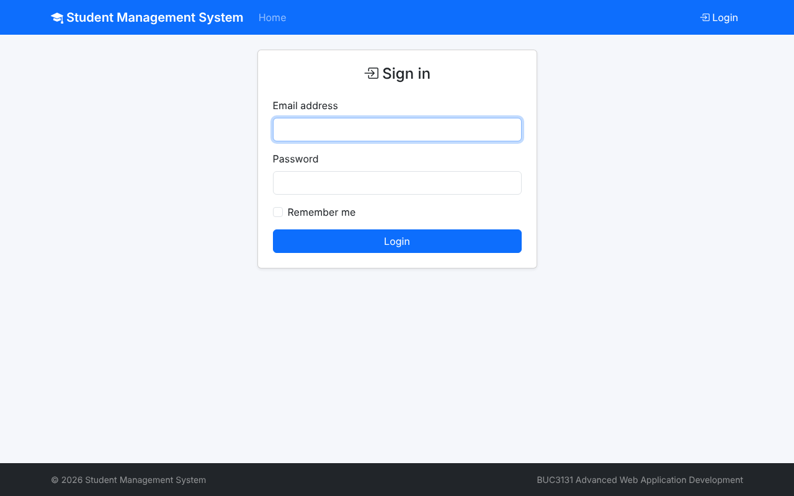 | Admin dashboard 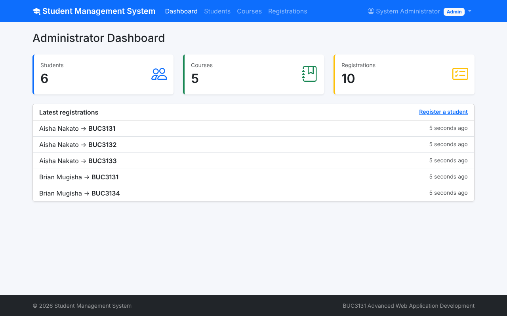 |
| Students 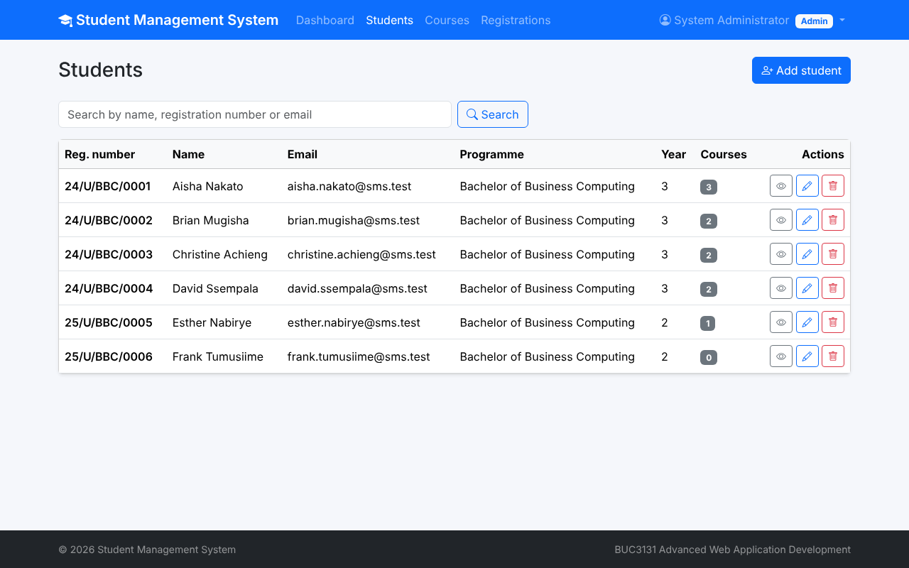 | Form validation 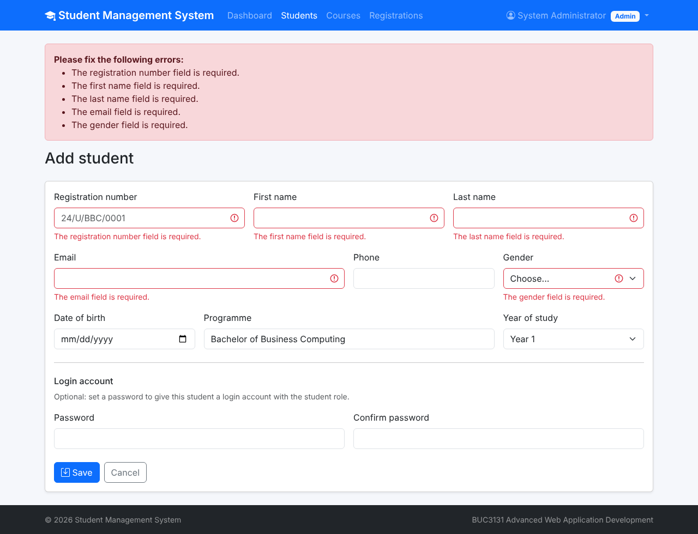 |
| Student details 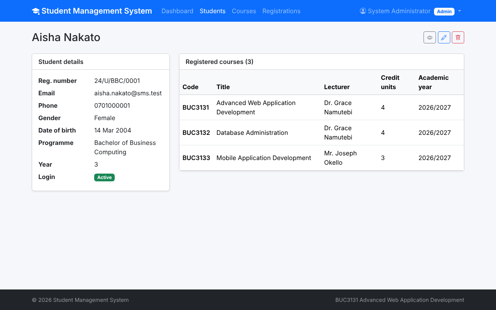 | Courses 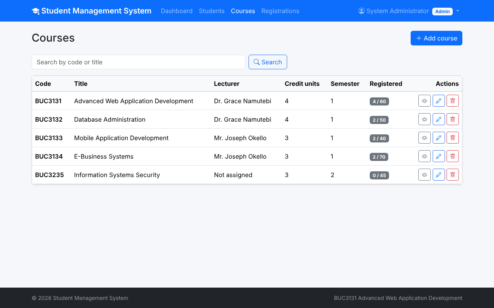 |
| Course class list 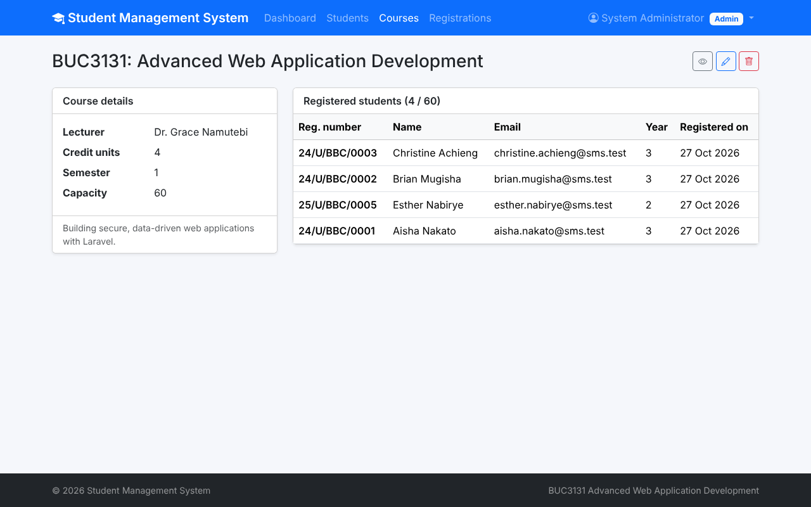 | All registrations 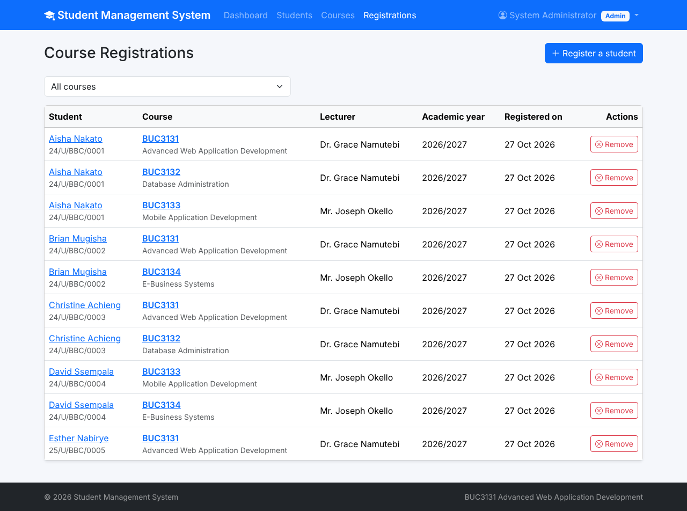 |
| Lecturer dashboard 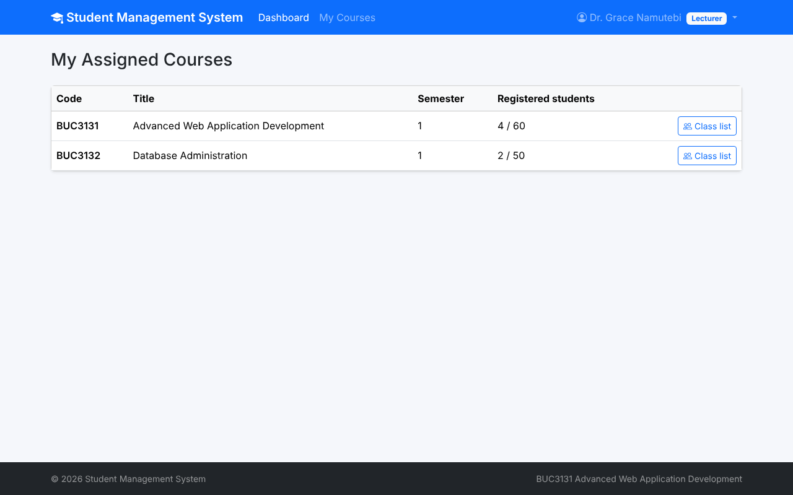 | Lecturer blocked from students 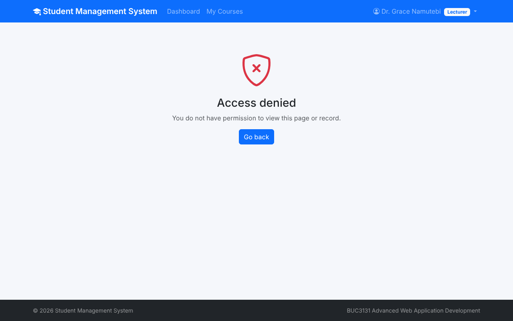 |
| Student dashboard 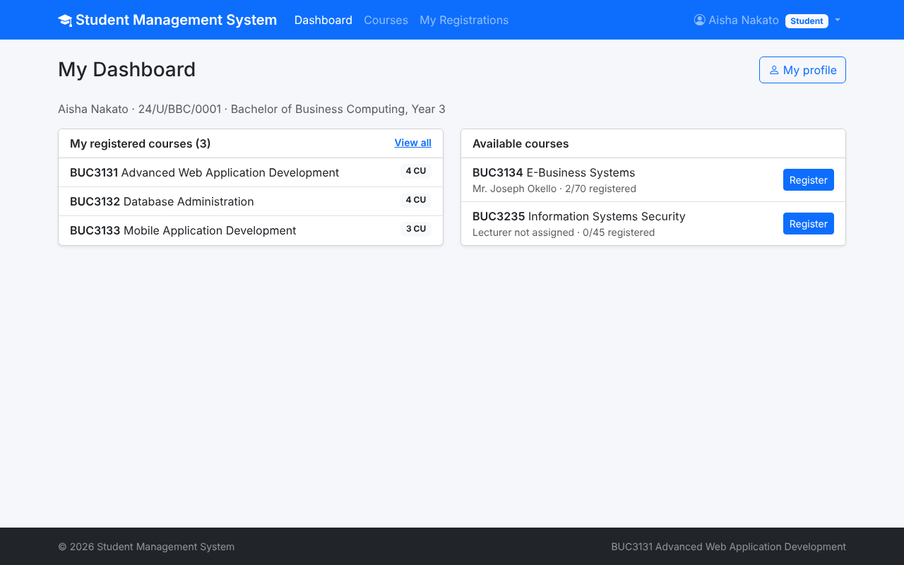 | Registration success message 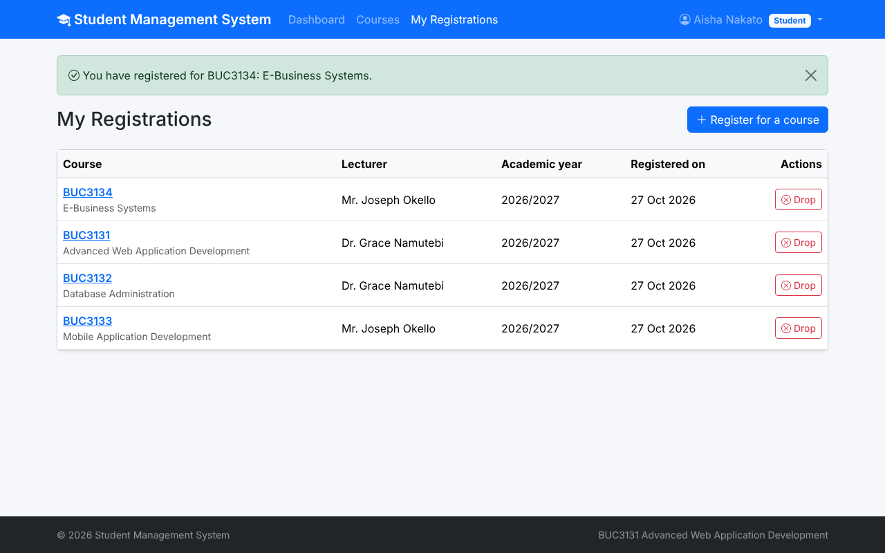 |

All screenshots are in [`docs/screenshots`](docs/screenshots).

## Project structure

```
app/Http/Controllers   Auth/LoginController, DashboardController, StudentController, CourseController, RegistrationController
app/Http/Requests      StudentRequest, CourseRequest, RegistrationRequest (validation)
app/Models             User, Student, Lecturer, Course, CourseRegistration
app/Policies           StudentPolicy, CoursePolicy, CourseRegistrationPolicy
database/migrations    lecturers, students, courses, course_registrations, permission tables
database/seeders       RolesAndPermissions, User, Student, Course, CourseRegistration
resources/views        layouts/app, partials, auth, dashboard, students, courses, registrations, errors
routes/web.php         guest, auth and resource routes
```

## Contribution report

See [`docs/CONTRIBUTION_REPORT.md`](docs/CONTRIBUTION_REPORT.md).
"# AWAD" 
